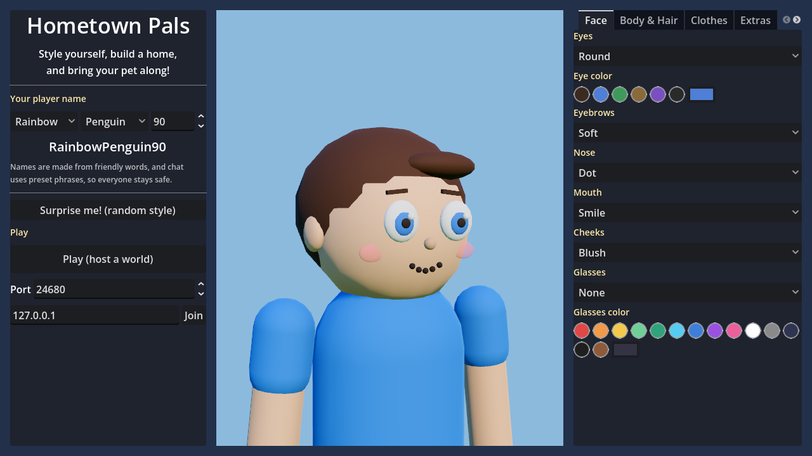
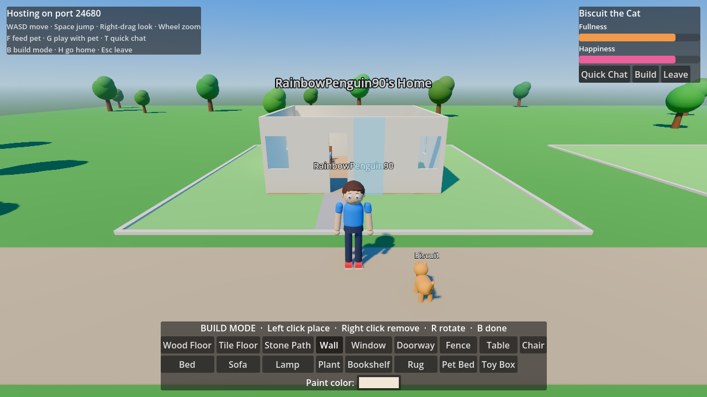

# Hometown Pals

An original online 3D neighborhood game for kids, built with **Godot 4.7+** (GDScript).
Style your character, build and decorate your own home, and bring your pet everywhere.




## Play in your browser

**https://allisonejohnson.github.io/madison-game/**

The browser version is rebuilt and published automatically every time `main` changes
(see [.github/workflows/web.yml](.github/workflows/web.yml)). It needs a keyboard and mouse, and it plays solo:
browsers can't use the network connection that online play needs, so playing with friends needs the
downloaded game below. Your character, pet and home are saved in the browser.

## Run it

1. Install [Godot 4.7 or newer](https://godotengine.org/download) (standard build, not .NET).
2. Open Godot, click **Import**, and pick this folder's `project.godot`.
3. Press **F5**. Style your character, then click **Play (host a world)**.

To play together on one computer: in the editor use **Debug > Customize Run Instances**, enable 2 instances, and run.
Have one window click Play and the other click Join with `127.0.0.1`.
To play across a home network, the host shares their local IP address and allows UDP port 24680 through the firewall.

## Controls

| Key | Action |
| --- | --- |
| WASD / arrows | Move |
| Space | Jump |
| Right mouse drag / wheel | Look around / zoom |
| F / G | Feed / play with your pet |
| T | Quick chat (preset phrases) |
| B | Build mode (left click place, right click remove, R rotate) |
| H | Go to your home |
| Esc | Leave the world |

## What's in the prototype

- **Character creator** with live 3D preview: skin tone, height, body shape; 6 eye styles, eye color,
  5 eyebrow styles, 4 noses, 6 mouths, blush and freckles, 4 glasses styles; 10 hair styles with any color;
  5 tops, 4 bottoms, 3 shoes, each with its own colors; 9 hats and hair clips; backpacks, capes and wings.
  Every color has kid-friendly swatches plus a full color picker. "Surprise me" randomizes everything.
- **Pets**: cat, dog, bunny, dragon or bird with three custom colors and a name. Pets follow you, wander
  when you stand still, react when fed or played with, and have fullness and happiness that slowly drop.
- **Houses**: each player gets a 12×12 plot with a starter house. Build mode places floors, walls,
  windows, doorways, fences and 10 furniture pieces on a grid, each in any color. Homes save automatically.
- **Online play**: up to 8 players in one neighborhood using Godot's high-level multiplayer (ENet).
- **Kid safety**: no free-text chat or typed names. See [docs/ARCHITECTURE.md](docs/ARCHITECTURE.md#kid-safety).

All art is built from simple shapes in code, so there are no asset files to manage yet.

## Developer helpers

To build the browser version yourself, install the 4.7.2 export templates (Editor > Manage Export Templates),
then use **Project > Export > Web**, or from a terminal:

```sh
godot --headless --export-release "Web" build/web/index.html
python3 -m http.server -d build/web 8000   # then open http://localhost:8000
```

```sh
# Two-process multiplayer smoke test (prints what each peer sees)
godot --headless --path . -- --host --smoke-test &
godot --headless --path . -- --join=127.0.0.1 --smoke-test

# Screenshots of the menu, or of your home in build mode
godot --path . -- --screenshot=/tmp/menu.png
godot --path . -- --host --shot-build --screenshot=/tmp/home.png
```
