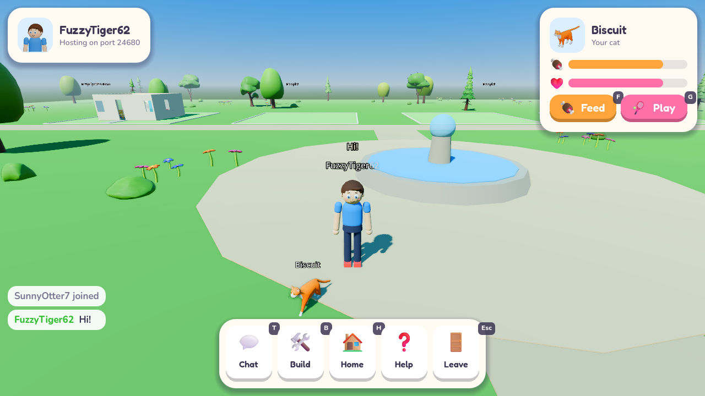

# Hometown Pals

An original online 3D neighborhood game for kids, built with **Godot 4.7+** (GDScript).
Style your character, build and decorate your own home, and bring your pet everywhere.




## Play in your browser

**https://allisonejohnson.github.io/madison-game/**

The browser version is rebuilt and published automatically every time `main` changes
(see [.github/workflows/web.yml](.github/workflows/web.yml)). It needs a keyboard and mouse, and it plays solo:
browsers can't use the network connection that online play needs, so playing with friends needs the
downloaded game below. Your character, pet and home are saved in the browser.

## Run it

1. Install [Godot 4.7 or newer](https://godotengine.org/download) (standard build, not .NET).
2. Open Godot, click **Import**, and pick this folder's `project.godot`.
3. Press **F5**. Style your character, then click **Play!** to start your own neighborhood.

To play together on one computer: in the editor use **Debug > Customize Run Instances**, enable 2 instances, and run.
Have one window click **Play!**, and in the other click **Play with friends** and Join `127.0.0.1`.
To play across a home network, the host shares their local IP address and allows UDP port 24680 through the firewall.

## Controls

Everything has a big on-screen button too, with its key shown in a small badge, and **Help** lists them all.

| Key | Action |
| --- | --- |
| WASD / arrows | Move |
| Space | Jump |
| Right mouse drag / wheel | Look around / zoom |
| E | Use what's here: the shop counter, the signpost by your home, Star Chase in Starfall Glade, or saying hi to a wild pet |
| F / G | Feed / play with your pet (the paw button on the pet card opens My pets) |
| T | Quick chat (preset phrases) |
| B | Decorate your home (left click place, right click or the wastebasket removes, R turn, E next look) |
| H | Go inside your home (walk out the front door to come back to town) |
| Shop button | Open the shop (or click your wallet) |
| Homes button | Buy homes, move into one, or add rooms (also from the decorating banner's Rooms button) |
| Esc | Close a window, then stop decorating, then ask before leaving the world |

Walk into the glowing portal west of the plaza to visit **Starfall Glade** (it opens at level 2), and through
its portal to come back. Tap the star on your player card to see your level and what's next.

**Admin console** (for the game's makers): press <kbd>`</kbd> (left of 1) to open it. It only exists when
running from the editor or with `godot --path . -- --admin`. `stardust 500` grants premium currency,
`acorns 500` grants earned currency, `member 30` adds 30 days of membership, `unlock all` owns everything in
the shop, every home and every room (`unlock reset` takes it back, except what you wear or have placed and
the home you live in with its rooms), `wallet` shows balances,
`xp 100` gives XP, `level 5` jumps to a level (`level` alone shows it, `level reset` starts over as a new
player), `boost 30` gives a 30-minute Star Boost, and `help` lists commands. Amounts can be negative to take
currency or XP away. It changes this device's save only.

## What's in the prototype

- **Kid-friendly UI**: one shared look (rounded cards, chunky buttons, color icons, two friendly fonts)
  with big tap targets and pictures instead of words wherever possible. Every option in the creator and
  every catalog item shows a rendered 3D picture of itself.
- **Decorating catalog made for big art packs**: category tabs, "All / Sofas / Lamps" chips, search,
  a Favorites tab (tap the star) and a Recently used tab, with paged picture cards. Only the visible page
  is built and its pictures render in the background (and are cached on disk), so it stays quick with
  the whole 800+ model furniture pack loaded.
- **Character creator** with live 3D preview, using the Cute Characters models: any skin color,
  height, 14 expressions with or without eyelashes, ears, 22 glasses, 24 face extras (from clown noses
  to mustaches), 30 hairstyles, 56 tops, 18 bottoms, 22 shoes and 58 hats (each in any color or its
  original colors), 9 outfits, socks, gloves, and 14 head-to-toe costumes (astronaut, dino, bee, penguin
  and more). Characters idle, walk, run and jump. Every color has kid-friendly swatches plus a full color
  picker, and "Surprise me" randomizes everything. Without the licensed art, the creator falls back to a
  simpler shape avatar with its own options.
- **Pets**: cats and kittens, dogs and birds (19 animated coats) are everyone's from the start. 13 more
  kinds live in the wild: a raccoon, fox and fawn in town; a bear cub, panda cub, koala, tiger cub and the
  rare glimmer cub and honey bear in Starfall Glade; a penguin chick, polar bear cub, lion cub and a rare
  pegasus in the Sky Garden. Walk up to one, say hi, give it a name and make friends (40 XP), and it
  waits at home until you bring it along from **My pets**. Most wild kinds can also be had at once for
  Stardust; the three rare ones can only be found. Pets follow you, walk and run, wander when you stand
  still, react when fed or played with, and each keeps its own fullness and happiness.
- **Homes**: each player gets a big plot in town with a ready-built home, starting with the free Sprout
  Cottage. Town only shows homes from outside: walk into the front door to go inside, to a space of its
  own, and back out the same way. Players decorate the inside with 18 kinds of furniture (beds, sofas, a
  fridge, a bathtub, an arcade machine and more), most in several styles; the walls and floors stay as
  built. Anyone can walk in to visit. Homes save automatically.
- **More homes and rooms**: the Homes window sells three more homes (the Oak Lookout under a giant oak,
  the Sunpatch Safari Camp's tents around a campfire, and Toadstool Hollow among giant mushrooms) and rooms
  to add to each, for Acorns once you reach their level, or for Stardust. Own as many as you like and move
  between them; each keeps its own furniture. Every home holds a set number of things, and each room
  added fits more. While decorating, rooms you could add show on your plot as outlines.
- **Starfall Glade**: a fantasy land through a portal in town, with a crystal plaza, a mushroom village,
  a lily pond, a castle, floating islands and wandering fantasy animals.
- **Earning**: Acorns float around town and Starfall Glade for anyone who walks into them (now and then a
  golden one is worth five times as much), and **Star Chase** by the glade's portal is a 45-second game of
  catching falling stars for Acorns.
- **Shop**: a stall in town (and one in the glade's market) sells furniture looks and clothes for Acorns,
  with a few special ones for Stardust, the premium currency. Prices show on every catalog card, in build
  mode and in the creator, where you can try anything on first. The starter home, the default character
  and the first look of most pieces stay free, and everything already in an older save stays owned.
- **Levels**: XP for picking up acorns, Star Chase, pet care, making friends with wild pets, decorating,
  exploring and coming back each day fills the bar on your player card. Each level pays Acorns, and many
  open something: Starfall Glade (and its wild pets) at level 2, the **Sky Garden** (a floating flower
  island above the glade) at level 5, new kinds of things in the shop, or a gift like the Bunny costume. A Star Boost (Stardust) doubles XP for 30 minutes.
- **Wallet**: Acorns (earned) and Stardust (premium) balances and membership, shown on the player card.
  Stardust can't be bought yet; the admin console grants it for testing.
- **Online play**: up to 8 players in one neighborhood using Godot's high-level multiplayer (ENet).
- **Kid safety**: no free-text chat or typed names. See [docs/ARCHITECTURE.md](docs/ARCHITECTURE.md#kid-safety).

Fonts are [Fredoka](https://fonts.google.com/specimen/Fredoka) and [Nunito](https://fonts.google.com/specimen/Nunito)
(SIL Open Font License) and icons are [Fluent Emoji](https://github.com/microsoft/fluentui-emoji) (MIT); their
licenses are next to them in `assets/ui/`.

The grass is the free [KayKit Forest Nature Pack](https://kaylousberg.itch.io/kaykit-forest)
by Kay Lousberg (CC0), kept in `assets/kaykit_forest`, which also supplies trees, bushes and rocks when the
licensed art is missing. Characters, furniture, pets, the town's trees and flowers and all of Starfall Glade
use licensed models from a private repo (see [docs/ARCHITECTURE.md](docs/ARCHITECTURE.md#art)). Without them
the game still runs, using simple shapes and the free forest models. To get them, clone that repo into an `itHappy` folder here before opening the project:

```sh
git clone https://github.com/AllisonEJohnson/madison-game-art.git itHappy
```

## Developer helpers

To build the browser version yourself, install the 4.7.2 export templates (Editor > Manage Export Templates),
then use **Project > Export > Web**, or from a terminal:

```sh
godot --headless --export-release "Web" build/web/index.html
python3 -m http.server -d build/web 8000   # then open http://localhost:8000
```

```sh
# Headless check of prices, buying, acorns, Star Chase and the shop (exit code = failures)
godot --headless --path . -- --host --economy-test

# Headless check of XP, level-ups, level-locked shop items and portals, and the Star Boost
godot --headless --path . -- --host --levels-test

# Headless check of every home's plan, buying homes and rooms, moving, capacity and old saves
godot --headless --path . -- --host --homes-test

# Headless check of pets: wild pets in every land, making friends, buying, switching, old saves
godot --headless --path . -- --host --pets-test

# Two-process multiplayer smoke test (prints what each peer sees)
godot --headless --path . -- --host --smoke-test &
godot --headless --path . -- --join=127.0.0.1 --smoke-test

# Screenshots of the menu, or of your home in build mode
godot --path . -- --screenshot=/tmp/menu.png
godot --path . -- --host --shot-build --screenshot=/tmp/home.png
# ...or of any spot: x/z/camera turn in degrees/tilt/distance (Starfall Glade starts at x 600)
godot --path . -- --host --shot-ui=goto:600/22/0/-0.45/26 --screenshot=/tmp/glade.png

# --shot-ui runs UI steps before the screenshot, for example a creator tab, a catalog
# category or search, or the whole furniture pack as a stress test (see scripts/dev/screenshot.gd)
godot --path . -- --shot-ui=tab:3 --screenshot=/tmp/clothes.png
godot --path . -- --host --shot-build --shot-ui=category:living --screenshot=/tmp/living.png
godot --path . -- --host --shot-build --shot-ui=stress --screenshot=/tmp/stress.png
godot --path . -- --host --shot-ui=shop:clothes,shopcat:hats --screenshot=/tmp/shop.png

# The same five views for comparing lighting changes; add --rendering-method gl_compatibility
# for the browser's renderer (see "The look" in docs/ARCHITECTURE.md)
godot --path . -s scripts/dev/look_tour.gd -- --host --tour=/tmp/look
```
